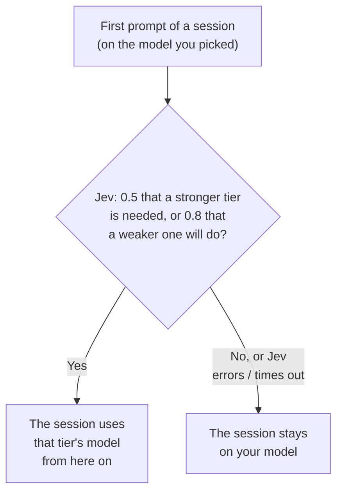
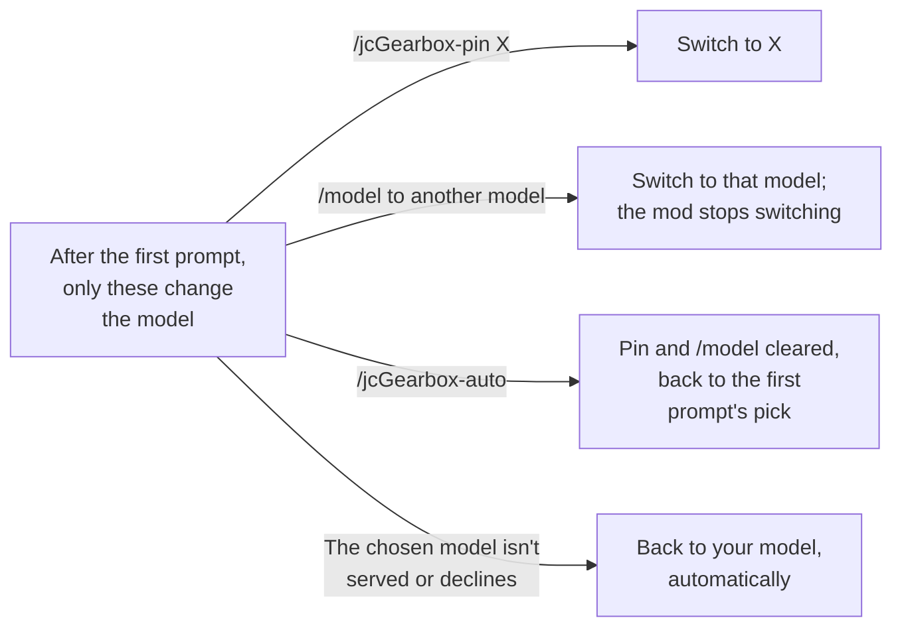
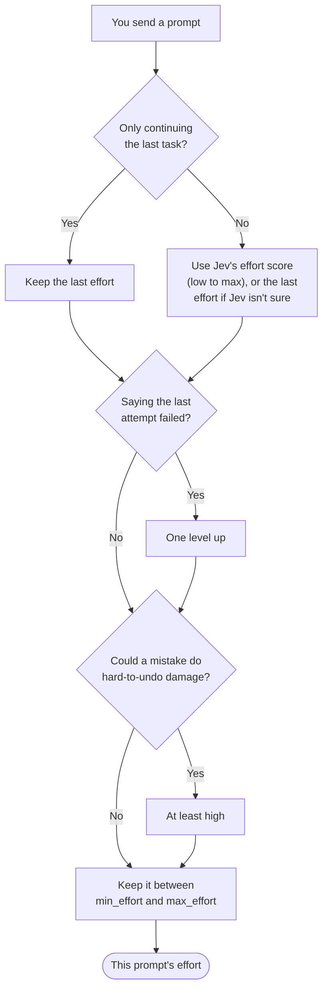

<p align="center">
  
</p>

# jcGearbox

English · [繁體中文](README.zh-TW.md)

## Why

In Claude Code you pick one model and one effort level and they apply to everything, so you either overpay for simple prompts (a rename on Opus at high effort) or under-power hard ones (a concurrency bug on a cheap model at low effort), unless you keep switching by hand. This mod makes that call for you: it asks Jev, a fast judgment model, how hard each prompt is and sets the model and effort to match, so easy work runs cheaper and faster and hard work gets the stronger model and more thinking.

A Claude Code mod that picks the model and the effort for you, from how hard [TypeSafe's Jev](https://typesafe.ai) judges the task to be. The first prompt of a session picks the model; every prompt picks the effort. Tiers and levels follow Anthropic's [model selection matrix](https://platform.claude.com/docs/en/about-claude/models/choosing-a-model#model-selection-matrix) and [effort levels](https://platform.claude.com/docs/en/build-with-claude/effort#effort-levels).

It starts in **shadow** mode: it shows its pick in the status line but sends your requests unchanged. Switch to `auto` once `/jcGearbox-log` has convinced you; the evidence that Jev judges difficulty well is thin.

> [!IMPORTANT]
> **A new model or effort costs the prompt cache.** Claude Code caches the conversation per model, and on most models per effort level too, so a change makes the next request read the whole conversation again, uncached ([Claude Code docs](https://code.claude.com/docs/en/prompt-caching)):
>
> - **Model**: every switch. That is why jcGearbox picks the model once per session. In `auto`, `/jcGearbox-pin`, `/jcGearbox-off`, `/jcGearbox-shadow` and `/model` mid-session are switches too.
> - **Effort**: every change, except on Opus 5.5, Sonnet 5.5, Haiku 5.5 and Fable 5.1 with an Anthropic API key or a Claude subscription. Amazon Bedrock, Google Cloud's Agent Platform (Vertex AI), the Claude apps gateway, `CLAUDE_CODE_DISABLE_EXPERIMENTAL_BETAS` and HIPAA organizations get no such exception, and neither do older models such as Opus 5 or 4.x.
>
> **So run jcGearbox on an Anthropic API key or a Claude subscription, with every tier on one of those four models** (`/jcGearbox-status` shows what each tier resolves to): there a new effort every prompt keeps the cache. Anywhere else, set `min_effort` and `max_effort` to the same level, so only the model is routed. `/jcGearbox-stats` shows how much of the prompt the cache served after a new effort and after none.

## Requirements

- Claude Code 2.1.286 or newer. Mods are an early-access API, so a Claude Code release can break this one.
- A TypeSafe API key from [console.typesafe.ai](https://console.typesafe.ai).

## Install

```
/plugin marketplace add KevinYu1580/jcGearbox
/plugin install jc-gearbox@jc-gearbox
```

Then run **`/jcGearbox-setup`**, which walks you through the key, the mode and the main settings. Without a key the mod does nothing and the status line says `no API key`.

**Recommended: turn on `send_assistant_tail`.** It is off by default because it sends the end of Claude's last reply to TypeSafe, but Jev judges much better with it: "here are the results" only makes sense next to what Claude asked for.

```bash
echo '{"send_assistant_tail": "true"}' | claude plugin configure jc-gearbox@jc-gearbox --values-stdin
```

## Picking the model

On a session's first prompt, Jev picks a tier. Options are listed Opus first, as the [official matrix](https://platform.claude.com/docs/en/about-claude/models/choosing-a-model#model-selection-matrix) says most work starts there.

| Tier | For | Default |
|---|---|---|
| `strong` | Complex agentic coding, large refactors, systems work, hard debugging | `opus` |
| `balanced` | Everyday coding, data analysis, agentic tool use | `sonnet` |
| `low` | Fast, cheap, high-volume or sub-agent style tasks | `haiku` |
| `long` | Agent sessions that run for hours, deep research | `fable` (costs the most; `off` disables it) |

- The model moves to a stronger tier's when Jev gives at least 0.5 (`tier_upgrade_probability`) that the task needs that tier or a stronger one, and to a weaker tier's only at 0.8 (`tier_min_probability`) that a weaker one will do; otherwise you stay on your model. A network error or 5xx from Jev on this prompt is retried once while a second is left.
- The choice holds for the whole session, to keep the prompt cache. A new session or `/clear` decides again. A resumed or forked conversation doesn't: a fork takes over the choice of the session it came from when it can tell which one that was, and otherwise keeps the model it has.
- If the API won't use a model (no access, not served) or the model declines the request, the mod stops asking for it in that session and the status line says why; `/jcGearbox-auto` asks for it again. An overload or a server error, which Claude Code itself treats as transient, doesn't count, nor does an account problem any model would meet (billing, an account on hold, cloud credentials that won't load). A failed sign-in or a rate limit counts only for a model that hasn't answered in the session yet: that is how a model not enabled on Bedrock or Vertex, or one billed to usage credits you don't have, fails.
- Switching to Fable this way skips the confirmation Claude Code shows before a model billed to usage credits: on a plan that bills Fable to credits, they are spent without asking. Set `long_model` to `off` if you don't want that.

### How the model changes in a session

The model is decided once, at the first prompt (diagram 1); after that, only the events in diagram 2 change it. Which model each tier means is up to your settings.





The diagrams show `auto`. In shadow mode the same decision is only shown in the status line.

## Picking the effort

Levels follow Anthropic's [effort docs](https://platform.claude.com/docs/en/build-with-claude/effort).

For every prompt you type:



1. Start from Jev's effort score (`low` to `max`). If the prompt only continues the last task ("ok", "go on", pasted output), keep the last effort. If Jev isn't sure of its score (confidence below `effort_min_confidence`, 0.7), keep the last effort too, and with none yet (on a session's first prompt, say) leave the effort as it is.
2. If you say the last attempt failed, go up one level.
3. If a mistake could do hard-to-undo damage (production, data deletion, migrations, auth, money, force-push), use at least `high`.
4. Keep it between `min_effort` and `max_effort` (`max_effort` wins).
5. Lower it to what the model takes:

| Model | Takes | Default when none is sent |
|---|---|---|
| Opus 5.5, Sonnet 5.5, Haiku 5.5 | `low`–`max` | `medium` |
| Opus 4.7 | `low`–`max` | `xhigh` |
| Fable, Mythos, Opus 5/4.8, Sonnet 5 | `low`–`max` | `high` |
| Opus 4.6, Sonnet 4.6, Mythos Preview | no `xhigh` (becomes `high`) | `high` |
| Opus 4.5 | up to `high` | `high` |
| Haiku 4.5 and older models | no effort | — |
| A model id the mod doesn't know | every level | `high` |

Prompts you didn't type (notifications, scheduled prompts) skip Jev and keep the session's model and the last effort; subagents, `claude -p` and Agent SDK runs are left alone (with `fork_follows_route` on, in auto a fork of the main conversation follows the session's model, except one made in a slash command's turn on the command's own model). A slash command or skill that sets its own model or effort keeps it for its turn. **Ultracode** isn't an effort level: it only lets Claude Code run workflows, so the mod routes the turn as usual and marks it `ultracode` in `/jcGearbox-log` when your prompt has the keyword (pasted text counts too, and whether workflows are on isn't checked). If Jev errors or doesn't answer within `jev_timeout_seconds` (3 s), nothing changes for that prompt and the status line says why. A request waits for Jev only when its answer can change it: never in shadow, nor after the first prompt once the effort is yours or the model takes none (slash commands still wait). Then only a first reply quicker than Jev waits for its answer, up to the timeout.

## Overriding it

| You | The mod |
|---|---|
| `/jcGearbox-pin <model>` | Uses that model for this session |
| `/model <name>` (even the model in use) or another model in the picker, after the first prompt | Stops changing the model for this session |
| `/effort <level>` (even the level in use) or another effort in the picker, after the first prompt | Stops changing the effort for this session |
| `/effort auto` (or `unset`) | Changes the effort again |
| `/jcGearbox-auto` | Drops all of the above |

Picking the session's original model again in the picker isn't a switch to Claude Code, so the mod doesn't see it and keeps its own pick: type `/model <name>`, or use `/jcGearbox-pin <model>`. An effort changed in the picker right after a resume or a plugin reload, before your next prompt, isn't noticed either: use `/effort <level>`.

## Commands

| Command | Does |
|---|---|
| `/jcGearbox-setup` | Guided setup |
| `/jcGearbox-status` (or `/jcGearbox`) | Mode, model, effort, the model each tier resolves to, Jev's last scores and version, and what the last request actually sent |
| `/jcGearbox-auto`, `/jcGearbox-shadow`, `/jcGearbox-off` | Mode for this session (`/jcGearbox-auto` also clears pins and asks again for models it stopped using) |
| `/jcGearbox-on` | Back on after `/jcGearbox-off`, in `default_mode` (`auto` when that is `off`); pins stay |
| `/jcGearbox-pin <model>` | Pin an alias or a full model id |
| `/jcGearbox-log [n]` | Last `n` decisions (default 20), across sessions |
| `/jcGearbox-stats` | How the logged decisions compare with what the engine would have run: first-turn model up, same or down, effort higher, same or lower, Jev's errors and latency, complaints; and how the turns went (answered, errors, interrupted, refused), how much of the prompt the cache served (in all, and after the same model and effort, a new effort or a new model as the session's last logged turn), and the rate limits at the last reading and their peak |

`/jcGearbox <action>` still works.

## Status line

```
opus-5-5·high          auto: what was sent
shadow ▸ opus-5-5·high   shadow: Jev's pick
```

In auto it's the model and effort actually sent; in shadow it's Jev's pick, and the request goes as the session has it. An effort of `?` means the mod changed the model and Claude Code works out the effort for the new model: the mod set none, or set the level Claude Code already had, which Claude Code doesn't count as a change. Only a Jev error adds a note, `Jev <error>`; the rest (a pin, `/model`, an effort of your own, `ultracode`, `Jev unsure`) is in `/jcGearbox-log`, and `/jcGearbox-status` shows the whole state. The model and effort at the bottom of Claude Code are the session's own setting, which shadow sends as it is and auto may rewrite; in auto, the status line is what was actually sent.

## Settings

Set them with `/jcGearbox-setup`, `/plugin configure jc-gearbox@jc-gearbox`, or `claude plugin configure … --values-stdin` (values as strings). Changes made in `/config` apply at once; otherwise run `/reload-plugins` or start a new session. They are stored under `pluginConfigs` in `~/.claude/settings.json`; `api_key` goes to Claude Code's secure storage.

| Setting | Default | Meaning |
|---|---|---|
| `api_key` | — | TypeSafe key; falls back to `TYPESAFE_API_KEY` |
| `default_mode` | `shadow` | `shadow`, `auto` or `off` for new sessions |
| `low_model`, `balanced_model`, `strong_model`, `long_model` | `haiku`, `sonnet`, `opus`, `fable` | Alias (`opus[1m]` for 1M context) or full model id; `off` disables the tier |
| `tier_upgrade_probability`, `tier_min_probability` | 0.5, 0.8 | Needed to move to a stronger, a weaker model |
| `continuation_threshold` | 0.6 | Above this, a prompt keeps the last effort |
| `effort_min_confidence` | 0.7 | Below this confidence, Jev's effort score isn't used and the last effort holds (a complaint or a risky task can still raise it); 0 always follows Jev |
| `signal_threshold` | 0.7 | Above this, "last attempt failed" and "risky" count |
| `min_effort`, `max_effort` | `low`, `max` | Range the mod sets; your own effort isn't capped |
| `jev_model` | `jev-latest` | Pin a version such as `jev-1.13.0`, which the thresholds were tuned on |
| `jev_timeout_seconds` | 3 | How long a request that Jev's answer can change waits for it (0.5–8) |
| `send_assistant_tail` | off (recommended on) | Also send the end of Claude's last reply |
| `assistant_tail_chars` | 1000 | How much of it (100–8000; ~700 tokens per 1000) |
| `fork_follows_route` | off | In auto, a subagent forked from the main conversation runs on the session's routed model, so it reads the conversation's prompt cache |

Aliases resolve only with an Anthropic login or API key; with an API key Claude Code keeps no model list, so they come from the mod's built-in table, which `/jcGearbox-status` marks `built-in`. An alias your model list doesn't offer (no access to Fable, say) turns its tier off. On Bedrock, Vertex, Foundry or a gateway, give at least two tiers full model ids. A session that picks Haiku stays on it until you pin another model.

## Privacy

For each prompt you send (typed, or through the desktop app, Remote Control or Slack; `claude -p` and Agent SDK runs are left alone), TypeSafe receives: the prompt (up to ~6000 characters; a longer one keeps its start and end), your previous prompt (up to ~1000), from the second prompt on the session's current model and last effort (a Bedrock ARN without its account), and, with `send_assistant_tail` on, the end of Claude's last reply. The text of a prompt you didn't type is never sent, but with `send_assistant_tail` on the end of Claude's reply to it can be. Files, code and tool results go only when they are in that text. Common key and token shapes (API keys, GitHub, AWS, Slack and Google keys, JWTs, private keys) are replaced with `[redacted]` before anything is sent or kept; other secrets you paste go as they are. Text Claude quotes from a web page or file can reach Jev in the reply's end and sway its judgment. TypeSafe's [privacy policy](https://typesafe.ai/legal/privacy-policy) says it does not train on this data but doesn't say how long it keeps it; servers are in the US, and zero retention is offered only on the enterprise plan. The mod asks Claude Code only whether you're logged in with an Anthropic account, to know whether aliases resolve; it never sees the credential.

Locally, in `~/.claude/plugins/store/jc-gearbox_*.json`, the mod keeps the first 200 characters of each prompt in its decision log (latest 200), each session's last prompt (up to ~1000 characters) and reply tail (latest 200 sessions; the session's next prompt replaces the reply tail, or deletes it with the option off), and a hash of the end of Claude's longer replies, to tell which session a fork came from (latest 200). Each decision also keeps the engine's own model and effort, how long Jev took, the turn's request and token counts, and how much of your rate limits was used. Delete the file to clear them.

## License

[MIT](LICENSE)
