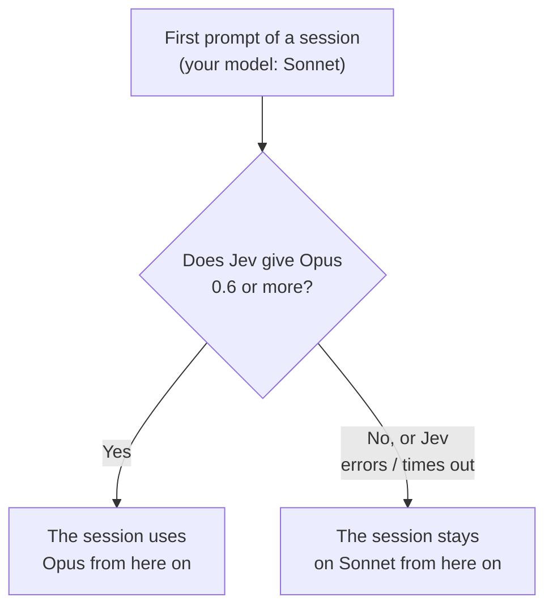
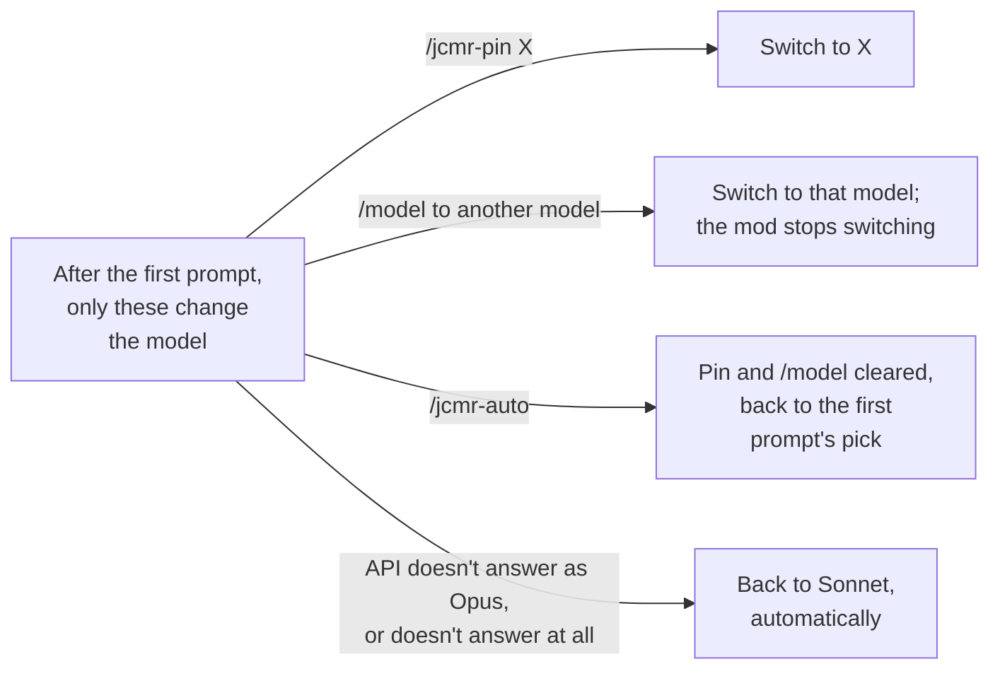

# jev-cc-model-router

English · [繁體中文](README.zh-TW.md)

A Claude Code mod that picks the model and the effort for you, from how hard [TypeSafe's Jev](https://typesafe.ai) judges the task to be. The first prompt of a session picks the model; every prompt picks the effort. Tiers and levels follow Anthropic's [model selection matrix](https://platform.claude.com/docs/en/about-claude/models/choosing-a-model#model-selection-matrix) and [effort levels](https://platform.claude.com/docs/en/build-with-claude/effort#effort-levels).

It starts in **shadow** mode: it shows its pick in the status line but sends your requests unchanged. Switch to `auto` once `/jcmr-log` has convinced you; the evidence that Jev judges difficulty well is thin.

## Requirements

- Claude Code 2.1.286 or newer. Mods are an early-access API, so a Claude Code release can break this one.
- A TypeSafe API key from [console.typesafe.ai](https://console.typesafe.ai).

## Install

```
/plugin marketplace add KevinYu1580/jev-cc-model-router
/plugin install jev-cc-model-router@jev-cc-model-router
```

Then run **`/jcmr-setup`**, which walks you through the key, the mode and the main settings. Without a key the mod does nothing and the status line says `jcmr: no API key`.

**Recommended: turn on `send_assistant_tail`.** It is off by default because it sends the end of Claude's last reply to TypeSafe, but Jev judges much better with it: "here are the results" only makes sense next to what Claude asked for.

```bash
echo '{"send_assistant_tail": "true"}' | claude plugin configure jev-cc-model-router@jev-cc-model-router --values-stdin
```

## Picking the model

On a session's first prompt, Jev picks a tier. Options are listed Opus first, as the matrix says most work starts there.

| Tier | For | Default |
|---|---|---|
| `strong` | Complex agentic coding, large refactors, systems work, hard debugging | `opus` |
| `balanced` | Everyday coding, data analysis, agentic tool use | `sonnet` |
| `low` | Fast, cheap, high-volume or sub-agent style tasks | `haiku` |
| `long` | Agent sessions that run for hours, deep research | `fable` (costs the most; `off` disables it) |

- The model changes only if the winner gets at least 0.6 (`tier_min_probability`); otherwise you stay on your model.
- The choice holds for the whole session, to keep the prompt cache. A new session, `/clear` or a fork decides again.
- If the API refuses a model (no access, not served), the mod stops asking for it in that session.

### How the model changes in a session

Say your model is Sonnet. The model is decided once, at the first prompt (diagram 1); after that, only the events in diagram 2 change it.





The diagrams show `auto`. In shadow mode the same decision is only shown in the status line.

## Picking the effort

For every prompt you type:


1. Start from Jev's effort score (`low` to `max`). If the prompt only continues the last task ("ok", "go on", pasted output), keep the last effort.
2. If you say the last attempt failed, go up one level.
3. If a mistake could do hard-to-undo damage (production, data deletion, migrations, auth, money, force-push), use at least `high`.
4. Keep it between `min_effort` and `max_effort` (`max_effort` wins).
5. Lower it to what the model takes:

| Model | Takes | Default when none is sent |
|---|---|---|
| Opus 5.5 | `low`–`max` | `medium` |
| Fable, Mythos, Opus 5/4.8/4.7, Sonnet 5.5/5 | `low`–`max` | `high` |
| Opus 4.6, Sonnet 4.6, Mythos Preview | no `xhigh` (becomes `high`) | `high` |
| Opus 4.5 | up to `high` | `high` |
| Haiku and older models | no effort | — |

Prompts you didn't type (notifications, scheduled prompts) and subagents are left alone. **Ultracode** isn't an effort level: it only lets Claude Code run workflows, so the mod routes the turn as usual and marks it `ultracode`. If Jev errors or doesn't answer within `jev_timeout_seconds` (3 s), nothing changes for that prompt and the status line says why.

## Overriding it

| You | The mod |
|---|---|
| `/jcmr-pin <model>` | Uses that model for this session |
| `/model` or the picker, after the first prompt | Stops changing the model for this session |
| `/effort` or the picker, after the first prompt | Stops changing the effort for this session |
| `/jcmr-auto` | Drops all of the above |

## Commands

| Command | Does |
|---|---|
| `/jcmr-setup` | Guided setup |
| `/jcmr-status` (or `/jcmr`) | Mode, model, effort, Jev's last scores, and what the last request actually sent |
| `/jcmr-auto`, `/jcmr-shadow`, `/jcmr-off` | Mode for this session (`/jcmr-auto` also clears pins) |
| `/jcmr-on` | Back on after `/jcmr-off`, in `default_mode`; pins stay |
| `/jcmr-pin <model>` | Pin an alias or a full model id |
| `/jcmr-log [n]` | Last `n` decisions (default 20), across sessions |

`/jcmr <action>` still works.

## Status line

```
jcmr ▸ opus-5-5·high                                 auto: what was sent
jcmr(shadow) ▸ sonnet-5-5·high · jev opus-5-5·high   shadow: sent, then Jev's pick
```

Notes follow when they apply: `ultracode`, `model pinned`, `effort pinned`, `try /jcmr pin opus`, `built-in model table`, `Jev <error>`. The model and effort at the bottom of Claude Code are the session's own setting and don't follow the mod; the status line is what was actually sent.

## Settings

Set them with `/jcmr-setup`, `/plugin configure jev-cc-model-router@jev-cc-model-router`, or `claude plugin configure … --values-stdin` (values as strings), then restart Claude Code. They are stored under `pluginConfigs` in `~/.claude/settings.json`; `api_key` goes to Claude Code's secure storage.

| Setting | Default | Meaning |
|---|---|---|
| `api_key` | — | TypeSafe key; falls back to `TYPESAFE_API_KEY` |
| `default_mode` | `shadow` | `shadow`, `auto` or `off` for new sessions |
| `low_model`, `balanced_model`, `strong_model`, `long_model` | `haiku`, `sonnet`, `opus`, `fable` | Alias or full model id; `off` disables the tier |
| `tier_min_probability` | 0.6 | Needed before the model changes |
| `continuation_threshold` | 0.6 | Above this, a prompt keeps the last effort |
| `signal_threshold` | 0.7 | Above this, "last attempt failed" and "risky" count |
| `min_effort`, `max_effort` | `low`, `max` | Range the mod sets; your own effort isn't capped |
| `jev_model` | `jev-latest` | Pin a version such as `jev-1.13.0` |
| `jev_timeout_seconds` | 3 | How long to wait for Jev (0.5–8) |
| `send_assistant_tail` | off (recommended on) | Also send the end of Claude's last reply |
| `assistant_tail_chars` | 1000 | How much of it (100–8000; ~700 tokens per 1000) |

Aliases resolve only with an Anthropic login. On Bedrock, Vertex, Foundry or a gateway, give at least two tiers full model ids. Haiku takes no effort and has a 200K context, and a session that picks it stays on it until you pin another model.

## Privacy

For each prompt you type, TypeSafe receives: the prompt (up to ~6000 characters), your previous prompt (up to ~1000), the session's current model and effort, and, with `send_assistant_tail` on, the end of Claude's last reply. Nothing else: no files, code or tool results unless they are in that text. TypeSafe's [privacy policy](https://typesafe.ai/legal/privacy-policy) says it does not train on this data but doesn't say how long it keeps it; servers are in the US.

Locally, the mod keeps the first 200 characters of each prompt in its decision log (latest 200), and each session's last prompt and reply tail (latest 200 sessions).

## License

[MIT](LICENSE)
