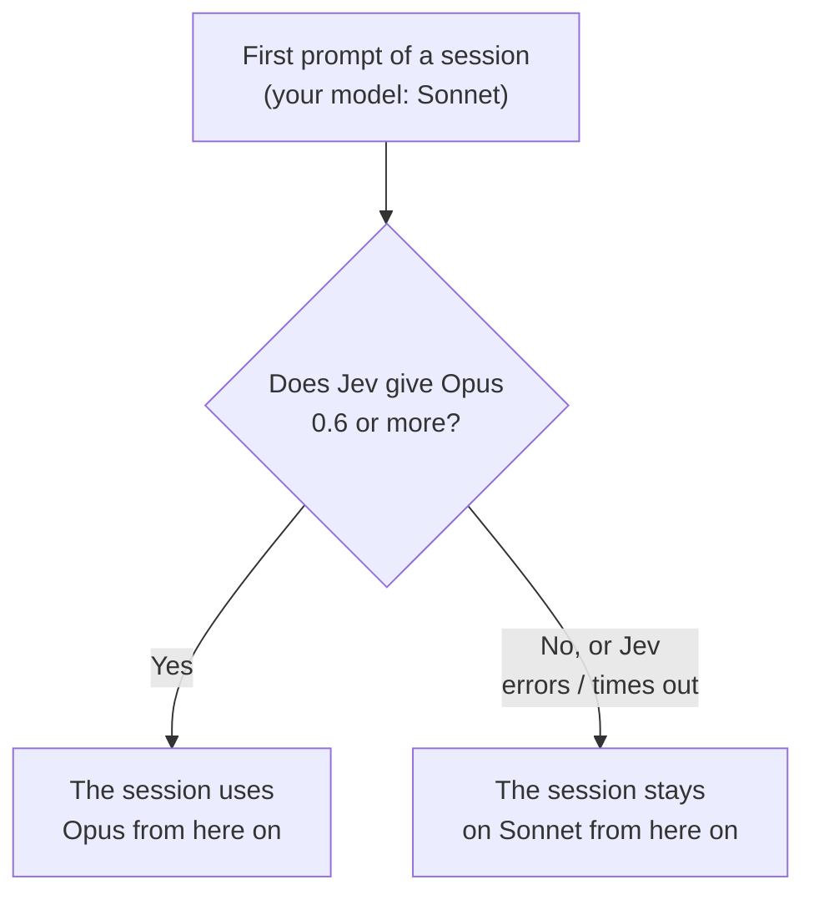
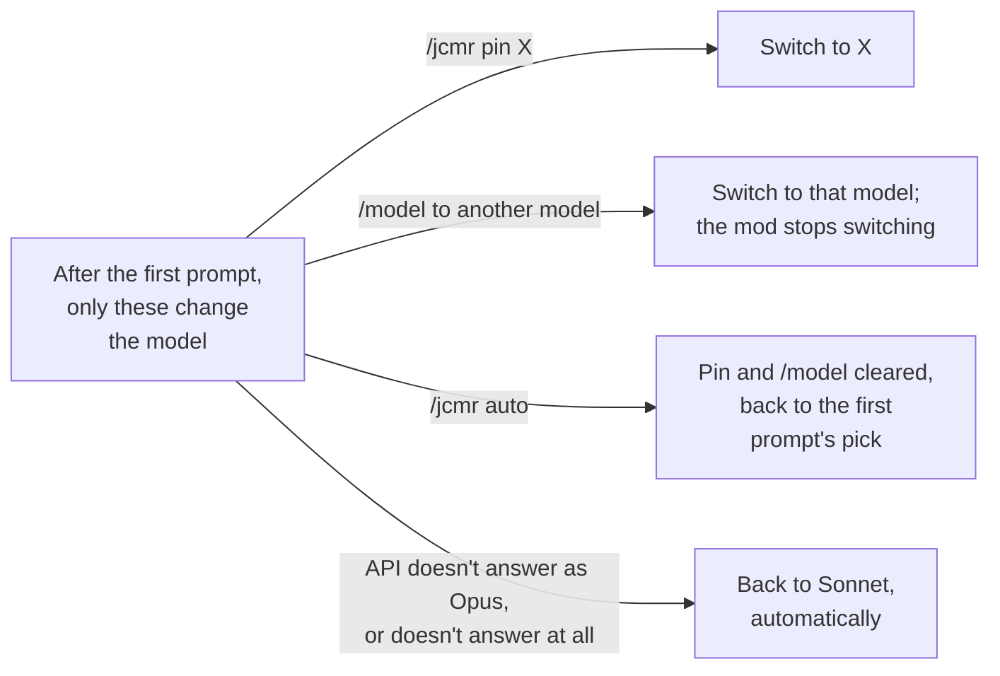
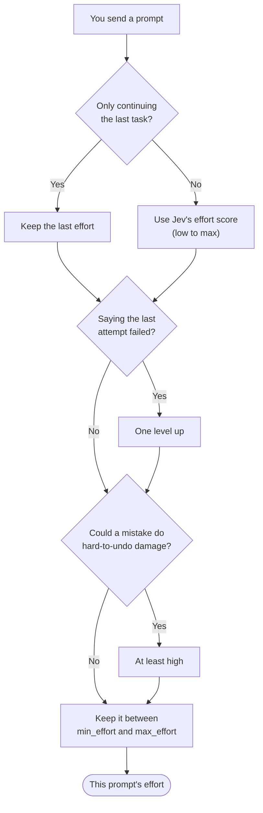

# jev-cc-model-router

English · [繁體中文](README.zh-TW.md)

Claude Code leaves the model and the effort to you. This mod sets them from how hard the task looks, as judged by [TypeSafe's Jev](https://typesafe.ai). The first prompt of a session picks the model: Haiku for quick work, Sonnet for everyday work, Opus for hard work, Fable for work that runs for hours. Every prompt you type, the first one included, picks the effort: lower for a quick question, higher when you say the last attempt failed or the task can break something.

A mod is a Claude Code plugin made of function hooks. This one starts in shadow mode: it judges every prompt and shows its pick in the status line, but sends your requests unchanged. The model tiers and effort levels follow Anthropic's official [model selection matrix](https://platform.claude.com/docs/en/about-claude/models/choosing-a-model#model-selection-matrix) and [effort levels](https://platform.claude.com/docs/en/build-with-claude/effort#effort-levels). Turn on `auto` once `/jcmr log` has shown you enough of its picks to trust them, because the evidence that Jev judges difficulty well is thin (see [Limitations](#limitations)).

## Requirements

- Claude Code 2.1.286 or newer. Mods are an early-access API, so any Claude Code release can break this one.
- A TypeSafe API key, from [console.typesafe.ai](https://console.typesafe.ai).

## Install

```
/plugin marketplace add KevinYu1580/jev-cc-model-router
/plugin install jev-cc-model-router@jev-cc-model-router
```

The repository is private for now, so these commands work only for GitHub accounts with access to it.

Put the key in the plugin's `api_key` setting (see [Settings](#settings)) or in the `TYPESAFE_API_KEY` environment variable. With neither, the mod does nothing and the status line says `jcmr: no API key`.

## Picking the model

On the first prompt you type in a session, Jev is asked which tier the task needs. Each tier maps to a model:

| Tier | For | Default model |
|---|---|---|
| `low` | Lowest latency and price: real-time or high-volume work, cost-sensitive tasks and sub-agent style tasks such as lookups, explanations, renames, formatting, running a command, one-line edits | `haiku` |
| `balanced` | Everyday coding, agents and enterprise work: code generation, data analysis, content creation, visual understanding and agentic tool use, such as a typical feature or bug fix in one module, writing tests, a single-file refactor | `sonnet` |
| `strong` | Complex agentic coding and enterprise work: autonomous coding agents running for hours, large refactors, complex systems engineering, vision-heavy workflows and computer use, such as cross-module design, hard debugging (concurrency, performance, memory), architecture or security decisions | `opus` |
| `long` | The highest capability available: agent sessions that run for hours, multistep deep research, analysis carried through to a finished document, spreadsheet or deck | `fable` |

The tiers follow the use cases in Anthropic's [model selection matrix](https://platform.claude.com/docs/en/about-claude/models/choosing-a-model#model-selection-matrix) (checked 2026-10-07): Haiku 4.5 for the lowest latency and price, Sonnet 5.5 for everyday coding, Opus 5.5 for complex agentic coding, Fable 5.1 for the highest capability.

Tiers on the same model add their probabilities together, so with the defaults the question is Haiku, Sonnet, Opus or Fable. Fable 5.1 costs the most, and some accounts can't use it (zero data retention, for one); set `long_model` to `off` if a session shouldn't move to it. If the API refuses it, the first prompt fails once and the mod stops asking for Fable in that session (see [Status line](#status-line)). If the tiers you've set map to fewer than two different models, there is nothing to choose and Jev isn't asked about the tier. The model changes only if the winner gets at least 0.6 (`tier_min_probability`); otherwise the session stays on the model you picked. A tie goes to the stronger model.

That choice holds for the rest of the session, because switching models halfway would throw away the prompt cache. The mod switches on its own only when the API didn't answer with the model it asked for (see [Status line](#status-line)); your own `/jcmr pin` and `/jcmr auto` switch it too. A new session, `/clear` or a fork decides again; `--resume` and compaction keep the choice, although the compaction request itself runs on the model you picked (see [Limitations](#limitations)).

### How the model changes in a session

Say your model in Claude Code is Sonnet. The model is decided once, at the first prompt (diagram 1). After that, only the events in diagram 2 change it.





- The diagrams show `auto` mode. In shadow mode the same decision is made but only shown in the status line, and requests keep your model. Running `/jcmr auto` mid-session applies the shown model from the next request.
- If your model is Opus, it works the other way round: the session moves to Sonnet only if Sonnet wins with 0.6 or more.
- If you interrupt while Jev is answering the first prompt, nothing is decided and your next prompt counts as the first. If Jev errors or doesn't answer within `jev_timeout_seconds` (3 s by default), there is no retry.
- "Doesn't answer at all" means a request got no response and the turn ended in an error. After that, or after the API answers as a different model, the mod stops requesting Opus and `/jcmr auto` returns to Sonnet. Picking Sonnet again in `/model` isn't detected; use `/jcmr pin sonnet` to go back.

## Picking the effort

The effort for each prompt you type is worked out in this order:



In words:

1. Start from Jev's effort score, mapped to `low`, `medium`, `high`, `xhigh` or `max`. Jev is asked which of Anthropic's [effort levels](https://platform.claude.com/docs/en/build-with-claude/effort#effort-levels) the work calls for: `low` for simple, scoped tasks, `medium` for a balance of speed and cost, `high` for complex reasoning and difficult coding, `xhigh` for long-horizon work (over 30 minutes), `max` for the deepest reasoning. If the prompt only continues the last task ("ok", "go ahead", a short answer), keep the last effort instead.
2. If you say the last attempt was wrong or failed, go up one level.
3. If a mistake could do damage that is hard to undo (production, deleting data, migrations, auth, money, force-push), use at least `high`. `xhigh` is left to long-running work.
4. Keep it between `min_effort` and `max_effort`. `max_effort` is applied last, so if the two conflict, or the risky rule asks for more than `max_effort`, `max_effort` wins.
5. Lower it to what the model takes (see the table below).

Jev answers "is this a continuation", "did the last attempt fail" and "is this risky" with a probability, and each counts only above 0.7 (`signal_threshold`). If you say the last attempt failed and it already ran at the ceiling (`max_effort`, `max` by default) on a model other than Opus or Fable, the status line suggests `/jcmr pin opus`. On a session's first prompt there is no last task or last attempt, so the first two questions are skipped.

Examples from real sessions (October 2026, prompts translated from Chinese):

| Prompt | What Jev said | Effort |
|---|---|---|
| "Analyse plan() in hooks/register.ts for concurrency problems; don't change any files" | effort score 2.62 | `xhigh` |
| "OK, go on" (right after the row above) | continuation 0.95 | keeps `xhigh` |
| "No, you missed the turn.complete part, check again" | failed 0.97, effort score 0.81 (`medium`) | one level up: `high` |
| "What are the risks of force-pushing main back to the first commit?" | risky 0.93, effort score 1.70 (`high`) | at least `high` |

Prompts you didn't type, such as background-task notifications, scheduled prompts and messages from other sessions, never go to Jev and keep the current model and effort. So does a prompt that another plugin rewrote before its turn started. Subagents are left alone.

### What each model takes

Anthropic's [effort table](https://platform.claude.com/docs/en/build-with-claude/effort#effort-levels) (checked 2026-10-07) decides what a request can carry. A level the model doesn't take is lowered before the request goes out:

| Model | Effort it takes | With no effort sent |
|---|---|---|
| Opus 5.5 | `low` to `max` | `medium` |
| Fable 5.1, Fable 5, Mythos 5.1, Mythos 5, Opus 5, Opus 4.8, Opus 4.7, Sonnet 5.5, Sonnet 5 | `low` to `max` | `high` |
| Opus 4.6, Sonnet 4.6, Mythos Preview | `low` to `max` except `xhigh`, which becomes `high` | `high` |
| Opus 4.5 | `low` to `high`; `xhigh` and `max` become `high` | `high` |
| Haiku 4.5, and models older than Opus 4.5 and Sonnet 4.6 | none; no effort is sent | none |
| A model id the mod doesn't know | every level | `high` |

### Ultracode

Ultracode isn't an effort level. Typing `ultracode` in a prompt, or turning it on with `/effort ultracode on`, lets Claude Code run multi-agent workflows; it changes neither the model nor the effort. So the mod never turns it on and routes an ultracode turn like any other. When you type the keyword, the status line and `/jcmr log` add `ultracode`, using Claude Code's own rule for what counts (not in a slash command, quotes, brackets or a path). A session-wide `/effort ultracode on` can't be seen by a mod, so it isn't marked.

## If Jev fails

When Jev returns an error or takes longer than `jev_timeout_seconds` (3 seconds by default), the mod makes no new decision and the status line says why (`Jev HTTP 401`, `Jev timeout`). On a session's first prompt the request goes out untouched and the session stays on your model from then on. On any later prompt, the session's model and the last effort stay as they were.

## Overriding it

| You | The mod |
|---|---|
| `/jcmr pin <alias or full id>` | Uses that model for this session (in `auto`) |
| Switch model with `/model` or the picker, after the first prompt | Stops changing the model for this session and drops any pin |
| Change the effort with `/effort` or the picker, after the first prompt, without also switching model | Stops changing the effort for this session |
| `/jcmr auto` | Drops all of the above. In a session that started in shadow, the model the status line showed applies from the next request, which rewrites the prompt cache once |

Also:

- The mod only counts an effort change made after the session's first prompt, and only to a level different from the last prompt's. To keep an effort you set before that, use `/jcmr off`.
- A slash command that carries its own effort (a skill's `effort:` frontmatter, `/code-review max`) keeps it for that turn and pins nothing. If that effort happens to equal the last prompt's, the mod can't tell and uses its own.
- Picking the session's original model again in `/model` is not a switch as far as Claude Code is concerned, so no switch event fires and the mod keeps its own pick. Use `/jcmr pin <model>` to go back.

## Commands

| Command | Does |
|---|---|
| `/jcmr` | Shows the mode, the model and effort state, Jev's scores for the last prompt, and the model and effort the last request actually carried (`sent`), with the same reasons |
| `/jcmr auto`, `/jcmr shadow`, `/jcmr off` | Sets the mode for this session only; new sessions start in `default_mode` |
| `/jcmr pin <model>` | Pins a model for this session. Refuses an alias it can't resolve and a model the API already didn't serve in this session |
| `/jcmr log [n]` | Lists the last `n` decisions (default 20) across all sessions. Each line starts with the model and effort the request carried. If Jev picked something else, `jev …` follows, then a reason (`pin`, `/model`, `shadow`, `ultracode`, `effort pinned`), and `served …` when the API answered as another model |

## Status line

```
jcmr ▸ opus-5-5·high                                 auto
jcmr(shadow) ▸ sonnet-5-5·high · jev opus-5-5·high   shadow: what was sent, then what auto would send
jcmr(shadow)                    after a start, /clear, /resume or /jcmr, until the next decision
jcmr: no API key
jcmr: needs Claude Code 2.1.286+
```

The model and effort right after `▸` are what the request carried; when it carried no effort, the model's default from the table above. `jev <model·effort>` follows when Jev's pick differs. In `auto` the short form is just `jcmr`; in `off` the line is empty. Notes follow when they apply: `ultracode`, `model pinned`, `effort pinned`, `try /jcmr pin opus`, `built-in model table`, `Jev <error>`.

If the API answers as a different model than the one requested, the mod stops asking for that model and shows `jcmr: <model> was not used (<model> answered); not switching to it again`. It does the same, with `no response` in the brackets, when a request gets no response and the turn ends in an error.

## Settings

Change them with `/plugin configure jev-cc-model-router@jev-cc-model-router` in Claude Code, or from a shell by piping a JSON object to `claude plugin configure jev-cc-model-router@jev-cc-model-router --values-stdin`, then restart Claude Code. The values live in `~/.claude/settings.json`:

```json
{
  "pluginConfigs": {
    "jev-cc-model-router@jev-cc-model-router": {
      "options": { "default_mode": "auto", "signal_threshold": 0.85 }
    }
  }
}
```

`api_key` is the exception: it is a sensitive field, so Claude Code keeps it in its secure storage, not in this file. `TYPESAFE_API_KEY` can be set in your shell or in the `env` block of the same `settings.json`.

In the `/plugin configure` menu, `default_mode`, `min_effort` and `max_effort` are pickers. The model fields take typed text, because they also accept full model ids, and a blank field means the default in the table below.

| Setting | Default | Meaning |
|---|---|---|
| `api_key` | empty | TypeSafe key. Falls back to `TYPESAFE_API_KEY` |
| `default_mode` | `shadow` | Mode for new sessions: `shadow`, `auto` or `off` |
| `low_model`, `balanced_model`, `strong_model` | `haiku`, `sonnet`, `opus` | An alias (`sonnet`, `opus`, `haiku`, `fable`) or a full model id; `off` turns the tier off |
| `long_model` | `fable` | An alias or a full model id; `off` turns the tier off. Fable 5.1 costs the most |
| `tier_min_probability` | 0.6 | Probability the winning model needs before the session's model changes |
| `signal_threshold` | 0.7 | Probability above which a continuation, a failed attempt or a risky task counts; one threshold for all three |
| `min_effort` | `low` | Lowest effort the mod sets |
| `max_effort` | `max` | Highest effort the mod sets; wins over `min_effort` and the risky rule. An effort you set yourself is not capped |
| `jev_model` | `jev-latest` | A version such as `jev-1.13.0` pins one |
| `jev_timeout_seconds` | 3 | How long the first request of each prompt you type waits for Jev, from 0.5 to 8. A longer wait gives Jev more time to answer, but when Jev is slow every prompt starts that much later |
| `send_assistant_tail` | off | Also send the last ~1000 characters of Claude's previous reply (see [Privacy](#privacy)) |

### Model names

A full model id is used as written. An alias (`haiku`, `sonnet`, `opus`, `fable`) becomes the current id from Claude Code's own model list, cached under `~/.claude/cache/model-catalog/` (or under `$CLAUDE_CONFIG_DIR` when that is set). If the list can't be read or has no usable model for the alias, the mod uses a built-in table and the status line says `built-in model table`.

Aliases only work when you're logged in to Claude Code with an Anthropic account. The mod checks this by calling Claude Code's `authorize()` and looking only at whether it answers. It never uses the handle that comes back, and it never reads or sends your credentials. On Bedrock, Vertex, Foundry or an LLM gateway, aliases resolve to nothing and their tiers are off. Give at least two tiers full ids of different models, or the mod will only adjust the effort.

Setting `low_model` to Haiku has a cost. Haiku takes no effort setting and has a 200K context window, and if the first prompt picks it, the session stays on Haiku until you `/jcmr pin` another model or switch with `/model` to a model other than the session's original one.

## Privacy

For each prompt you type, TypeSafe receives only:

- the prompt, up to about 6000 characters (a longer one keeps its start and its end);
- your previous prompt, up to about 1000 characters;
- from the second prompt on, the session's current model and the last effort;
- with `send_assistant_tail` on, the last ~1000 characters of Claude's previous reply.

Code, file contents and tool results are not sent unless they are in your prompt or `send_assistant_tail` is on. The text of a prompt you didn't type is never sent; with `send_assistant_tail` on, though, the end of Claude's reply to it can be.

TypeSafe says it does not train on this data, but not how long it keeps it.<!-- TODO: link TypeSafe's data policy --> Its servers are in the US, and zero retention is offered only on the enterprise plan.

On your machine, in Claude Code's plugin store, the mod keeps:

- the first 200 characters of each prompt, in the decision log (the latest 200 decisions);
- your last prompt in each session, up to 1000 characters (the latest 200 sessions);
- with `send_assistant_tail` on, the end of Claude's last reply in each session. It stays until that session's record is pruned, even after you turn the option off.

## Limitations

- There is little evidence that Jev can judge task difficulty. The evaluation of a reference implementation reports an AUC of 0.570, with a confidence interval that includes chance,<!-- TODO: name and link the reference implementation --> and there is no data on Traditional Chinese prompts.
- In a first desktop test (October 2026, `jev-latest`), Jev scored two short, unrelated questions as continuations, at 0.79 and 0.80, and both inherited the last prompt's effort, `high` and `xhigh`. Raising `signal_threshold` to 0.85 would have rejected both, but also a real continuation that scored 0.77, and it would make the failure and risk signals harder to trigger as well.
- Compaction (automatic or `/compact`) and Claude Code's other side requests don't go through the hook the mod uses to rewrite requests. They run on the model you picked, at the session's own effort. When the mod has moved the session to another model, those requests can't read the conversation's prompt cache, and your picked model writes the summary.
- The model list cache is an internal Claude Code file. If its format changes, the mod falls back to its built-in table, which needs updating when new models ship.
- Only Opus 5.5 (Claude Code 2.1.280 and later) and Sonnet 5.5 (2.1.286) have been seen to keep the prompt cache when the effort changes, on a small sample.

## Development

```
claude plugin validate .claude-plugin/plugin.json
claude plugin validate .
claude plugin test .
```

Run both validations. On a folder that has a `marketplace.json`, `claude plugin validate .` checks only the marketplace; the first command is the one that checks the hooks module.

To try a local checkout, start Claude Code with `claude --plugin-dir /path/to/jev-cc-model-router`. The desktop app takes no flags, so add the folder to `CLAUDE_CODE_PLUGIN_DIRS` in the `env` block of `~/.claude/settings.json` instead, with `CLAUDE_CODE_PLUGIN_DIR_WATCH=1` to reload on save. A checkout loaded this way reads its options from `pluginConfigs["jev-cc-model-router"]` rather than the installed plugin's entry. The design notes are in [docs/SPEC.md](docs/SPEC.md), in Traditional Chinese.

## License

[MIT](LICENSE)
