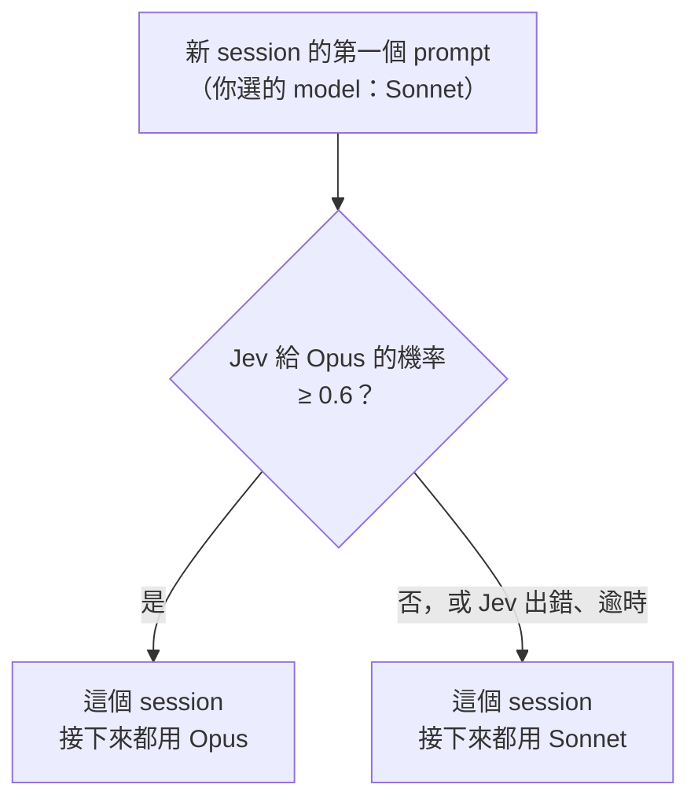
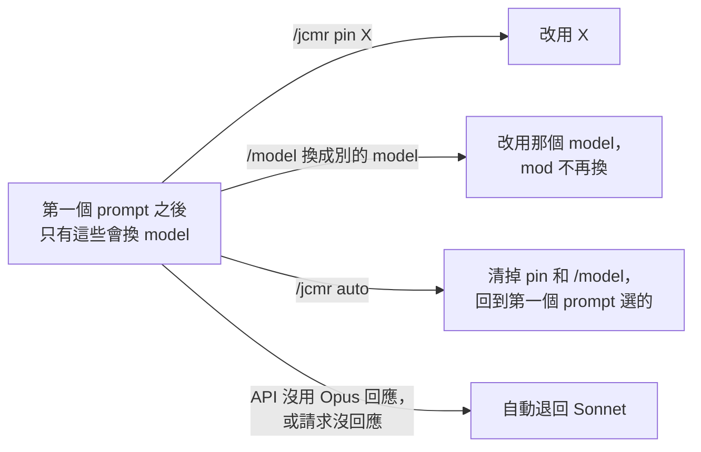
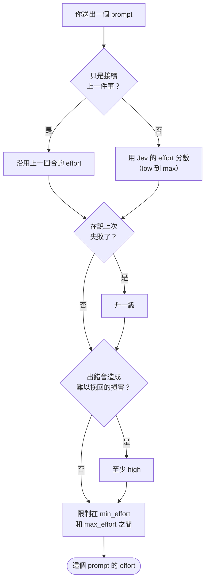

# jev-cc-model-router

[English](README.md) · 繁體中文

Claude Code 的 model 和 effort 都要自己選。這個 mod 改由 [TypeSafe 的 Jev](https://typesafe.ai) 判斷任務難度來決定：session 的第一個 prompt 決定 model，簡單的用 Haiku，平常用 Sonnet，難題用 Opus，要跑好幾小時的用 Fable；每個 prompt（包括第一個）則決定 effort，簡單的問題調低，你說上次失敗或任務可能闖禍時調高。

mod 是用 function hooks 寫成的 Claude Code plugin。這個 mod 預設是 shadow 模式：每個 prompt 都判斷，結果顯示在狀態列，但請求原樣送出。model tier 和 effort 等級都依照 Anthropic 官方的 [model 選擇矩陣](https://platform.claude.com/docs/zh-TW/about-claude/models/choosing-a-model#model-selection-matrix)和 [effort 等級](https://platform.claude.com/docs/zh-TW/build-with-claude/effort#effort-levels)設計。等 `/jcmr log` 裡的判斷讓你放心了，再切到 `auto`；Jev 判斷難度準不準，目前證據很薄（見[已知限制](#已知限制)）。

## 需求

- Claude Code 2.1.286 以上。mod 是 early access 的 API，任何一版 Claude Code 都可能讓它失效。
- TypeSafe API key，到 [console.typesafe.ai](https://console.typesafe.ai) 申請。

## 安裝

```
/plugin marketplace add KevinYu1580/jev-cc-model-router
/plugin install jev-cc-model-router@jev-cc-model-router
```

repo 目前是私人的，只有能存取它的 GitHub 帳號才能用這兩行安裝。

把 key 填進 plugin 設定的 `api_key`（見[設定](#設定)），或設成環境變數 `TYPESAFE_API_KEY`。兩者都沒有時 mod 什麼都不做，狀態列顯示 `jcmr: no API key`。

## 怎麼選 model

session 裡你送出的第一個 prompt，會請 Jev 判斷任務需要哪個 tier，每個 tier 對應一個 model：

| tier | 適用 | 預設 model |
|---|---|---|
| `low` | 最低延遲與價格：即時或大量的工作、對成本敏感的任務，以及子代理型的任務，例如查詢、解釋、改名、排版、執行指令、改一行 | `haiku` |
| `balanced` | 日常 coding、代理與企業工作：程式碼生成、資料分析、內容創作、視覺理解、代理式工具使用，例如單一模組內的功能或 bug 修正、寫測試、單檔重構 | `sonnet` |
| `strong` | 複雜的代理式 coding 與企業工作：持續數小時的自主 coding agent、大規模重構、複雜系統工程、大量運用視覺的工作流程、電腦使用，例如跨模組設計、困難的除錯（並行、效能、記憶體）、架構或資安決策 | `opus` |
| `long` | 現有最高能力：持續數小時的 agent session、多步驟深度研究、一路做到完成文件、試算表或簡報的分析 | `fable` |

tier 依照 Anthropic 官方 [model 選擇矩陣](https://platform.claude.com/docs/zh-TW/about-claude/models/choosing-a-model#model-selection-matrix)的使用情境（2026-10-07 查閱）：Haiku 4.5 給最低延遲與價格，Sonnet 5.5 給日常 coding，Opus 5.5 給複雜 agentic coding，Fable 5.1 給最高能力。

幾個 tier 對應到同一個 model 時，機率會加總，所以照預設設定，是在 Haiku、Sonnet、Opus 和 Fable 之間選。Fable 5.1 最貴，有些帳號也不能用（例如零資料保留）；不想讓 session 切到它，請把 `long_model` 設成 `off`。API 拒絕時，第一個 prompt 會失敗一次，之後這個 session 不再要求 Fable（見[狀態列](#狀態列)）。你設定的 tier 如果對應不到兩個以上不同的 model，就沒得選，也不會問 Jev tier 題。勝出的 model 機率要有 0.6（`tier_min_probability`）才會換，不到就維持你選的 model；平手時選較強的。

這個選擇會維持到 session 結束，因為中途換 model 會讓 prompt cache 失效。mod 只有在 API 沒用它要求的 model 回應時才會自己換回去（見[狀態列](#狀態列)）；你自己下的 `/jcmr pin`、`/jcmr auto` 也會換。新 session、`/clear` 或 fork 會重新選，`--resume` 和對話壓縮都沿用原本的選擇，不過壓縮請求本身仍用你選的 model（見[已知限制](#已知限制)）。

### 一個 session 裡 model 怎麼變

假設你在 Claude Code 選的 model 是 Sonnet：model 只在第一個 prompt 決定一次（圖 1），之後只有圖 2 這幾件事會換掉它。





- 圖畫的是 `auto` 模式。預設的 shadow 模式判斷方式相同，但結果只顯示在狀態列，請求仍用你選的 model。中途下 `/jcmr auto` 的話，狀態列顯示的 model 會從下一個請求開始生效。
- 你選的是 Opus 時就反過來：Sonnet 勝出且機率 ≥ 0.6，才會換成 Sonnet。
- Jev 還在回答第一個 prompt 時你按了中斷，這次不算，下一個 prompt 才算第一個。Jev 出錯或逾時（`jev_timeout_seconds`，預設 3 秒）則不重試。
- 「請求沒回應」指請求沒有回應、該回合以錯誤結束。發生這種情況，或 API 用別的 model 回應之後，mod 就不再要求 Opus，`/jcmr auto` 也只會回到 Sonnet。在 `/model` 選回原本的 Sonnet 偵測不到，要回去請用 `/jcmr pin sonnet`。

## 怎麼選 effort

每個你送出的 prompt，effort 依下面的順序決定：



文字版：

1. 從 Jev 的 effort 分數出發，對應到 `low`、`medium`、`high`、`xhigh` 或 `max`。Jev 被問的是：這個工作屬於官方 [effort 等級](https://platform.claude.com/docs/zh-TW/build-with-claude/effort#effort-levels)的哪一級：`low` 簡單、範圍小的任務，`medium` 速度與成本的平衡，`high` 複雜推理與困難 coding，`xhigh` 長時間（超過 30 分鐘）的工作，`max` 最深度的推理。如果只是接續上一件事（「好」、「繼續」、簡短回答），改用上一回合的 effort。
2. 你說上次做錯或失敗了，就升一級。
3. 出錯可能造成難以挽回的損害時（正式環境、刪資料、資料庫遷移、認證、金流、force-push），至少用 `high`。`xhigh` 留給長時間的工作。
4. 最後限制在 `min_effort` 和 `max_effort` 之間。`max_effort` 最後套用，所以兩者衝突，或「有風險」要求的等級超過 `max_effort` 時，以 `max_effort` 為準。
5. 再降到 model 能用的等級（見下表）。

「是不是接續」、「上次有沒有失敗」、「有沒有風險」這三題，Jev 都回答一個機率，超過 0.7（`signal_threshold`）才算數。你說上次失敗、而那次已經用到上限（`max_effort`，預設 `max`），且 model 不是 Opus 或 Fable 時，狀態列會建議 `/jcmr pin opus`。session 的第一個 prompt 沒有「上一件事」也沒有「上次」，所以跳過前兩題。

實際 session 的例子（2026 年 10 月）：

| prompt | Jev 的判斷 | effort |
|---|---|---|
| 「分析 hooks/register.ts 的 plan() 有沒有並行問題，不要改任何檔案」 | effort 分數 2.62 | `xhigh` |
| 「好，繼續」（緊接在上一列之後） | 接續 0.95 | 沿用 `xhigh` |
| 「不對，你漏看了 turn.complete 那段，重新檢查一次」 | 上次失敗 0.97，effort 分數 0.81（`medium`） | 升一級：`high` |
| 「如果要把 main 分支 force-push 回第一個 commit，風險是什麼？」 | 有風險 0.93，effort 分數 1.70（`high`） | 至少 `high` |

不是你打的 prompt，例如背景任務通知、排程 prompt、其他 session 傳來的訊息，不會送給 Jev，沿用目前的 model 和 effort。你的 prompt 如果在回合開始前被其他 plugin 改寫，也比照處理。subagent 的 model 和 effort 一律不動。

### 各 model 能用的 effort

一個請求能帶哪個 effort，依官方 [effort 等級表](https://platform.claude.com/docs/zh-TW/build-with-claude/effort#effort-levels)（2026-10-07 查閱）。model 不支援的等級，送出前會降下來：

| model | 能用的 effort | 沒送 effort 時 |
|---|---|---|
| Opus 5.5 | `low` 到 `max` | `medium` |
| Fable 5.1、Fable 5、Mythos 5.1、Mythos 5、Opus 5、Opus 4.8、Opus 4.7、Sonnet 5.5、Sonnet 5 | `low` 到 `max` | `high` |
| Opus 4.6、Sonnet 4.6、Mythos Preview | `low` 到 `max`，但沒有 `xhigh`，會改成 `high` | `high` |
| Opus 4.5 | `low` 到 `high`；`xhigh` 和 `max` 改成 `high` | `high` |
| Haiku 4.5，以及比 Opus 4.5、Sonnet 4.6 舊的 model | 不支援，不送 effort | 無 |
| mod 不認得的 model ID | 全部等級 | `high` |

### Ultracode

ultracode 不是 effort 等級。在 prompt 裡打 `ultracode`，或用 `/effort ultracode on` 開啟，只是讓 Claude Code 可以跑多 agent workflow，不會改 model，也不會改 effort。所以 mod 不會自己開啟它，ultracode 回合也照常選 model 和 effort。你打了這個關鍵字時，狀態列和 `/jcmr log` 會加註 `ultracode`；怎樣才算關鍵字，照 Claude Code 自己的規則（不在 slash command、引號、括號或路徑裡）。整個 session 用 `/effort ultracode on` 開啟的，mod 看不到，所以不會標示。

## Jev 出錯時

Jev 回傳錯誤，或超過 `jev_timeout_seconds`（預設 3 秒）沒回應，mod 就不做新決策，狀態列顯示原因（`Jev HTTP 401`、`Jev timeout`）。如果是 session 的第一個 prompt，請求原樣送出，這個 session 從此都用你選的 model；不是第一個 prompt 的話，就維持 session 的 model 和上一回合的 effort。

## 手動覆寫

| 你做的事 | mod 的反應 |
|---|---|
| `/jcmr pin <別名或完整 ID>` | 這個 session 改用該 model（`auto` 模式下） |
| 第一個 prompt 之後，用 `/model` 或選單換 model | 這個 session 不再改 model，也清掉 pin |
| 第一個 prompt 之後，用 `/effort` 或選單改 effort（沒有同時換 model） | 這個 session 不再改 effort |
| `/jcmr auto` | 清掉以上的 pin 和手動設定。從 shadow 開始的 session，狀態列顯示的 model 會從下一個請求開始生效，prompt cache 會因此重寫一次 |

另外：

- mod 只認第一個 prompt 之後的 effort 改動，而且要改成跟上一個 prompt 不同的等級才算。第一個 prompt 之前就設好的 effort，要保留它請用 `/jcmr off`。
- 自帶 effort 的 slash command（skill frontmatter 的 `effort:`、`/code-review max`）只在那一回合用它自己的 effort，不算固定。但如果它剛好跟上一個 prompt 的 effort 一樣，mod 分不出來，會改用自己的 effort。
- 在 `/model` 選回 session 原本的 model，Claude Code 不當成有換，不會發出切換事件，mod 會繼續用它自己選的 model。要回去請用 `/jcmr pin <model>`。

## 指令

| 指令 | 作用 |
|---|---|
| `/jcmr` | 顯示模式、model 和 effort 的狀態，上一則 prompt 的 Jev 分數，以及上一個請求實際帶的 model 和 effort（`sent`，附同樣的原因）|
| `/jcmr auto`、`/jcmr shadow`、`/jcmr off` | 只改這個 session 的模式；新 session 從 `default_mode` 開始 |
| `/jcmr pin <model>` | 這個 session 固定用某個 model。對應不到 ID 的別名，或這個 session 裡 API 沒用它回應過的 model，會被拒絕 |
| `/jcmr log [n]` | 列出最近 `n` 筆決策（預設 20），包含所有 session。每行開頭是請求實際帶的 model 和 effort。Jev 選的不同時，後面接 `jev …`，再接原因（`pin`、`/model`、`shadow`、`ultracode`、`effort pinned`）；API 用別的 model 回應時再加 `served …` |

## 狀態列

```
jcmr ▸ opus-5-5·high                                 auto
jcmr(shadow) ▸ sonnet-5-5·high · jev opus-5-5·high   shadow：先是實際送出的，再來是開 auto 會送的
jcmr(shadow)                    啟動、/clear、/resume 或 /jcmr 之後，到下一個決策之前
jcmr: no API key
jcmr: needs Claude Code 2.1.286+
```

`▸` 後面的 model 和 effort 是請求實際帶的；請求沒帶 effort 時，顯示上表該 model 的預設值。Jev 選的不同時，後面接 `jev <model·effort>`。`auto` 模式的簡短形式就是 `jcmr`；`off` 模式不顯示。視情況在後面加註：`ultracode`、`model pinned`、`effort pinned`、`try /jcmr pin opus`、`built-in model table`、`Jev <錯誤>`。

API 回應的 model 跟要求的不同時，mod 不再要求那個 model，並顯示 `jcmr: <model> was not used (<model> answered); not switching to it again`。請求完全沒有回應、回合又因錯誤結束時也一樣，括號裡改成 `no response`。

## 設定

在 Claude Code 裡用 `/plugin configure jev-cc-model-router@jev-cc-model-router` 修改，或在終端機把 JSON 物件 pipe 給 `claude plugin configure jev-cc-model-router@jev-cc-model-router --values-stdin`，改完重開 Claude Code。設定值存在 `~/.claude/settings.json`：

```json
{
  "pluginConfigs": {
    "jev-cc-model-router@jev-cc-model-router": {
      "options": { "default_mode": "auto", "signal_threshold": 0.85 }
    }
  }
}
```

`api_key` 例外：它是敏感欄位，Claude Code 把它放在自己的安全儲存區，不寫進這個檔案。`TYPESAFE_API_KEY` 可以設在 shell，或同一個 `settings.json` 的 `env` 區塊。

在 `/plugin configure` 選單裡，`default_mode`、`min_effort` 和 `max_effort` 可以用左右鍵選；model 欄位因為也要能填完整 model ID，只能直接打字，留空代表用下表的預設值。

| 設定 | 預設 | 說明 |
|---|---|---|
| `api_key` | 空 | TypeSafe key。沒填就讀 `TYPESAFE_API_KEY` |
| `default_mode` | `shadow` | 新 session 的模式：`shadow`、`auto` 或 `off` |
| `low_model`、`balanced_model`、`strong_model` | `haiku`、`sonnet`、`opus` | 別名（`sonnet`、`opus`、`haiku`、`fable`）或完整 model ID；填 `off` 停用該 tier |
| `long_model` | `fable` | 別名或完整 model ID；填 `off` 停用。Fable 5.1 最貴 |
| `tier_min_probability` | 0.6 | 勝出的 model 要有多少機率，才換掉 session 的 model |
| `signal_threshold` | 0.7 | 「接續」、「上次失敗」、「有風險」的機率要超過多少才算；三題共用這個門檻 |
| `min_effort` | `low` | mod 設定的最低 effort |
| `max_effort` | `max` | mod 設定的最高 effort；蓋過 `min_effort` 和「有風險」規則。你自己設的 effort 不受限制 |
| `jev_model` | `jev-latest` | 填版本號（如 `jev-1.13.0`）就固定在那一版 |
| `jev_timeout_seconds` | 3 | 你送出的每個 prompt，第一個請求最多等 Jev 幾秒（0.5–8）。等得越久，Jev 越有機會回答，但 Jev 慢的時候，每個 prompt 也會晚這麼久才開始 |
| `send_assistant_tail` | 關 | 一併送出 Claude 上一則回答的最後約 1000 字（見[隱私](#隱私)） |

### model 名稱

完整 model ID 照填的用。別名（`haiku`、`sonnet`、`opus`、`fable`）會從 Claude Code 自己的 model 清單對應到目前的 ID，清單快取在 `~/.claude/cache/model-catalog/`（有設 `CLAUDE_CONFIG_DIR` 時在它底下）。清單讀不到，或裡面沒有這個別名可用的 model，就改用內建對照表，狀態列會顯示 `built-in model table`。

別名只在你用 Anthropic 帳號登入 Claude Code 時有效。mod 用 Claude Code 的 `authorize()` 判斷這一點，只看它有沒有回應：拿到的 handle 不會用，也不會讀取或送出你的憑證。使用 Bedrock、Vertex、Foundry 或 LLM gateway 時，別名對應不到 ID，設成別名的 tier 就停用。請至少替兩個 tier 填上不同 model 的完整 ID，否則 mod 只會調整 effort。

`low_model` 設成 Haiku 有代價：Haiku 不吃 effort 設定，context 只有 200K，而第一個 prompt 一旦選到它，整個 session 就停在 Haiku，除非你用 `/jcmr pin` 換掉，或用 `/model` 換到 session 原本以外的 model。

## 隱私

你送出的每個 prompt，TypeSafe 只會收到：

- 這則 prompt，最多約 6000 字（太長就保留開頭和結尾）；
- 你的上一則 prompt，最多約 1000 字；
- 從第二個 prompt 起，session 目前的 model 和上一回合的 effort；
- 開啟 `send_assistant_tail` 時，Claude 上一則回答的最後約 1000 字。

程式碼、檔案內容和工具結果都不送，除非它們就在你的 prompt 裡，或你開了 `send_assistant_tail`。不是你打的 prompt，內容一律不送；但開了 `send_assistant_tail` 時，Claude 對它的回答結尾仍可能送出。

TypeSafe 表示不拿這些資料訓練，但沒寫明保留多久。<!-- TODO: 補上 TypeSafe 資料政策的連結 -->伺服器在美國，只有 enterprise 方案提供 zero retention。

在你的電腦上（Claude Code 的 plugin store），mod 會保存：

- 每則 prompt 的前 200 字，記在決策紀錄裡（保留最近 200 筆）；
- 每個 session 的上一則 prompt，最多 1000 字（保留最近 200 個 session）；
- 開啟 `send_assistant_tail` 時，每個 session 中 Claude 上一則回答的結尾。關掉選項後它仍會留著，直到那個 session 的紀錄被清掉。

## 已知限制

- Jev 能不能判斷任務難度，證據很少：某個參考實作的評測 AUC 是 0.570，信賴區間包含亂猜<!-- TODO: 寫明是哪個參考實作並附連結 -->，也沒有繁體中文 prompt 的數據。
- 第一次在桌面 App 實測時（2026 年 10 月，`jev-latest`），Jev 把兩則簡短、無關的問題判成接續（0.79 和 0.80），這兩則就沿用了上一個 prompt 的 `high` 和 `xhigh`。把 `signal_threshold` 調到 0.85 能擋下這兩則，但也會擋掉一則真正的接續（0.77），而且「上次失敗」和「有風險」兩題共用這個門檻，也會跟著變嚴。
- 對話壓縮（自動或 `/compact`）和 Claude Code 的其他附屬請求，不經過 mod 用來改寫請求的那個 hook，所以會用你選的 model 和 session 原本的 effort。mod 已經把 session 換到別的 model 時，這些請求讀不到對話的 prompt cache，摘要也由你選的 model 寫。
- model 清單快取是 Claude Code 的內部檔案，格式改了 mod 就退回內建對照表，而內建表要在新 model 推出時更新。
- 換 effort 不會讓 prompt cache 失效，這點只在 Opus 5.5（Claude Code 2.1.280 以後）和 Sonnet 5.5（2.1.286）上看過，樣本少。

## 開發

```
claude plugin validate .claude-plugin/plugin.json
claude plugin validate .
claude plugin test .
```

兩個 validate 都要跑。資料夾裡有 `marketplace.json` 時，`claude plugin validate .` 只驗 marketplace，hooks module 要靠第一行才驗得到。

要試用本機版本，用 `claude --plugin-dir /path/to/jev-cc-model-router` 啟動。桌面 App 不能帶參數，改在 `~/.claude/settings.json` 的 `env` 加 `CLAUDE_CODE_PLUGIN_DIRS` 指向這個資料夾，再加 `CLAUDE_CODE_PLUGIN_DIR_WATCH=1` 就能存檔即重載。這樣載入的版本從 `pluginConfigs["jev-cc-model-router"]` 讀設定，不是讀已安裝版本那一筆。設計文件在 [docs/SPEC.md](docs/SPEC.md)。

## 授權

[MIT](LICENSE)
