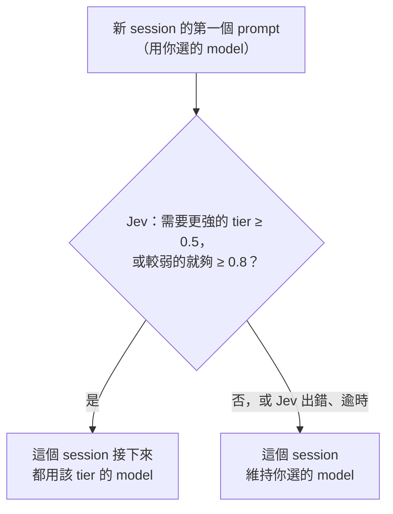
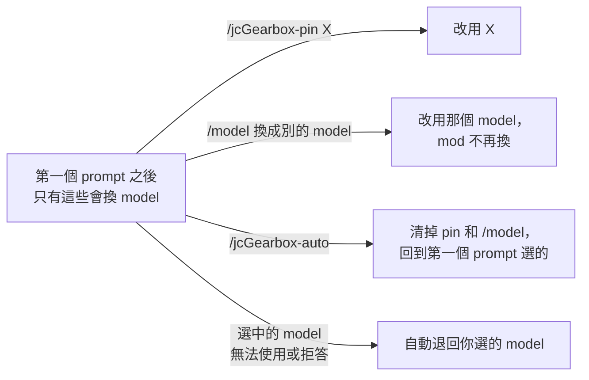
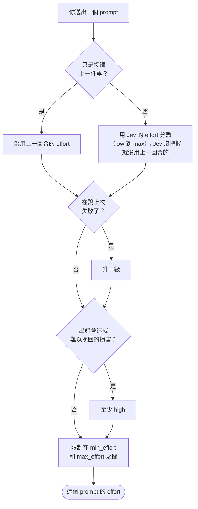

<p align="center">
  
</p>

# jcGearbox

[English](README.md) · 繁體中文

## 解決什麼問題

在 Claude Code 裡，你選一個 model 和一個 effort，之後所有 prompt 都用它。結果不是簡單的事也付大錢（用 Opus、high effort 改個變數名），就是難題用了太弱的設定（用便宜的 model、low effort 查並行 bug），除非你一直手動切換。這個 mod 替你做這個判斷：每個 prompt 都先問 Jev（一個快速的判斷 model）有多難，再配合調整 model 和 effort。簡單的工作更便宜、更快，難的工作用更強的 model、想得更多。

這是一個 Claude Code mod，依 [TypeSafe 的 Jev](https://typesafe.ai) 判斷的任務難度，替你選 model 和 effort。session 的第一個 prompt 決定 model，每個 prompt 決定 effort。tier 和等級依照 Anthropic 官方的 [model 選擇矩陣](https://platform.claude.com/docs/zh-TW/about-claude/models/choosing-a-model#model-selection-matrix)和 [effort 等級](https://platform.claude.com/docs/zh-TW/build-with-claude/effort#effort-levels)設計。

預設是 **shadow** 模式：只在狀態列顯示它的選擇，請求原樣送出。看 `/jcGearbox-log` 覺得可信後再切到 `auto`；Jev 判斷難度準不準，目前證據還很少。

> [!IMPORTANT]
> **換 model 或 effort 會讓 prompt cache 失效。** Claude Code 的對話快取依 model 分開，多數 model 還依 effort 等級分開；一換，下一個請求就要把整段對話重新讀過，沒有快取（[Claude Code 文件](https://code.claude.com/docs/zh-TW/prompt-caching)）：
>
> - **model**：每次切換都會。所以 jcGearbox 每個 session 只選一次 model。`auto` 模式下，session 中途用 `/jcGearbox-pin`、`/jcGearbox-off`、`/jcGearbox-shadow` 或 `/model` 也算切換。
> - **effort**：每次改都會，只有 Opus 5.5、Sonnet 5.5、Haiku 5.5、Fable 5.1 搭配 Anthropic API key 或 Claude 訂閱時例外。Amazon Bedrock、Google Cloud 的 Agent Platform（Vertex AI）、Claude apps gateway、設了 `CLAUDE_CODE_DISABLE_EXPERIMENTAL_BETAS`、HIPAA 組織都沒有這個例外，Opus 5、4.x 這類較舊的 model 也沒有。
>
> **因此建議用 Anthropic API key 或 Claude 訂閱，而且每個 tier 都落在這四個 model 上**（各 tier 實際對應哪個 model，看 `/jcGearbox-status`）：這樣每個 prompt 換 effort 也不會讓快取失效。其他環境請把 `min_effort` 和 `max_effort` 設成同一級，只讓 mod 選 model。`/jcGearbox-stats` 會列出換了 effort 和沒換時，prompt 從快取讀到的比例。

## 需求

- Claude Code 2.1.286 以上。mod 是 early access API，Claude Code 改版可能讓它失效。
- TypeSafe API key，到 [console.typesafe.ai](https://console.typesafe.ai) 申請。

## 安裝

```
/plugin marketplace add KevinYu1580/jcGearbox
/plugin install jc-gearbox@jc-gearbox
```

接著執行 **`/jcGearbox-setup`**，它會一步步帶你設好 key、模式和主要設定。沒有 key 時 mod 什麼都不做，狀態列顯示 `no API key`。

**建議開啟 `send_assistant_tail`。** 它預設是關的，因為會把 Claude 上一則回答的結尾送到 TypeSafe；但開了之後 Jev 判斷準很多：「結果如下」要搭配 Claude 要你做什麼，才看得懂。

```bash
echo '{"send_assistant_tail": "true"}' | claude plugin configure jc-gearbox@jc-gearbox --values-stdin
```

## 怎麼選 model

session 的第一個 prompt 會請 Jev 選 tier。選項把 Opus 放第一，因為[官方矩陣](https://platform.claude.com/docs/zh-TW/about-claude/models/choosing-a-model#model-selection-matrix)說多數工作從它開始。

| Tier | 用途 | 預設 |
|---|---|---|
| `strong` | 複雜的代理式 coding、大型重構、系統工程、困難除錯 | `opus` |
| `balanced` | 日常 coding、資料分析、代理式工具使用 | `sonnet` |
| `low` | 快速、便宜、大量或子代理型的任務 | `haiku` |
| `long` | 持續數小時的 agent session、深度研究 | `fable`（最貴；填 `off` 停用） |

- Jev 給「需要這個 tier 或更強」至少 0.5 的機率（`tier_upgrade_probability`）時，換成較強 tier 的 model；給「較弱的就夠」至少 0.8（`tier_min_probability`）時，才換成較弱 tier 的 model；否則維持你選的 model。這個 prompt 遇到 Jev 的網路錯誤或 5xx，時間還剩一秒以上就重試一次。
- 選擇會維持整個 session，避免 prompt cache 失效。新 session 或 `/clear` 會重新選；接續或 fork 的對話不會：fork 認得出來源 session 時沿用它的選擇，否則維持原本的 model。
- API 不讓用某個 model（沒有權限、沒有提供），或 model 拒答時，這個 session 不會再要求它。過載或伺服器錯誤（Claude Code 自己也視為暫時性）不算。
- 這樣換成 Fable 時，不會出現 Claude Code 對「用 usage credits 計費的 model」的確認視窗：如果你的方案把 Fable 算進 credits，會直接扣。不想要就把 `long_model` 設成 `off`。

### 一個 session 裡 model 怎麼變

model 只在第一個 prompt 決定一次（圖 1），之後只有圖 2 這幾件事會換掉它。每個 tier 對應哪個 model，由你的設定決定。





圖畫的是 `auto` 模式；shadow 模式判斷方式相同，但只顯示在狀態列。

## 怎麼選 effort

等級依照官方的 [effort 文件](https://platform.claude.com/docs/zh-TW/build-with-claude/effort)。

每個你送出的 prompt：



1. 從 Jev 的 effort 分數出發（`low` 到 `max`）。如果只是接續上一件事（「好」、「繼續」、貼上輸出），沿用上一回合的 effort。Jev 對自己的分數沒把握時（信心度低於 `effort_min_confidence`，0.7），也沿用上一回合的；還沒有上一回合的 effort 時（例如 session 的第一個 prompt），就不改 effort。
2. 你說上次失敗了，就升一級。
3. 出錯可能造成難以挽回的損害時（正式環境、刪資料、資料庫遷移、認證、金流、force-push），至少用 `high`。
4. 限制在 `min_effort` 和 `max_effort` 之間（以 `max_effort` 為準）。
5. 再降到該 model 能用的等級：

| model | 能用 | 沒送 effort 時 |
|---|---|---|
| Opus 5.5、Haiku 5.5 | `low`–`max` | `medium` |
| Fable、Mythos、Opus 5/4.8/4.7、Sonnet 5.5/5 | `low`–`max` | `high` |
| Opus 4.6、Sonnet 4.6、Mythos Preview | 沒有 `xhigh`（改成 `high`） | `high` |
| Opus 4.5 | 最高 `high` | `high` |
| Haiku 4.5 和更舊的 model | 不支援 effort | — |
| mod 不認得的 model ID | 全部等級 | `high` |

不是你打的 prompt（通知、排程）不問 Jev，沿用 session 的 model 和上一回合的 effort；子代理、`claude -p` 和 Agent SDK 的執行一律不動（開啟 `fork_follows_route` 時，auto 模式下從主對話 fork 出去的子代理跟著 session 的 model；slash command 自帶 model 的那一回合 fork 出去的，維持 command 的 model）。slash command 或 skill 自己指定的 model 或 effort，在它那一回合照它的。**Ultracode** 不是 effort 等級，只是讓 Claude Code 能跑 workflow，所以照常選 model 和 effort；prompt 裡有這個關鍵字時，在 `/jcGearbox-log` 標示 `ultracode`（貼上的文字也算，也不檢查 workflow 有沒有開）。Jev 出錯或超過 `jev_timeout_seconds`（3 秒）沒回應時，這個 prompt 什麼都不改，狀態列會顯示原因。只有 Jev 的答案能改變請求時，請求才會等它：shadow 從不等；第一個 prompt 之後，effort 由你決定或 model 不支援 effort 時也不等（slash command 仍會等）。這時只有比 Jev 還快回來的第一則回覆，會等它的答案，最多到逾時。

## 手動覆寫

| 你 | mod |
|---|---|
| `/jcGearbox-pin <model>` | 這個 session 改用該 model |
| 第一個 prompt 之後打 `/model <名稱>`（即使是目前的 model），或在選單換成別的 model | 這個 session 不再改 model |
| 第一個 prompt 之後打 `/effort <等級>`（即使是目前的等級），或在選單換成別的 effort | 這個 session 不再改 effort |
| `/jcGearbox-auto` | 清掉以上全部 |

在選單選回 session 原本的 model，Claude Code 不當成有換，mod 偵測不到，會繼續用它自己選的 model：請打 `/model <名稱>`，或用 `/jcGearbox-pin <model>`。resume 或重載 plugin 之後、送出下一個 prompt 之前在選單改的 effort 也偵測不到：請用 `/effort <等級>`。

## 指令

| 指令 | 作用 |
|---|---|
| `/jcGearbox-setup` | 引導設定 |
| `/jcGearbox-status`（或 `/jcGearbox`） | 模式、model、effort、各 tier 對應的 model、上一則的 Jev 分數與版本，以及上個請求實際送出的值 |
| `/jcGearbox-auto`、`/jcGearbox-shadow`、`/jcGearbox-off` | 這個 session 的模式（`/jcGearbox-auto` 會一併清掉 pin） |
| `/jcGearbox-on` | `/jcGearbox-off` 之後重新開啟，回到 `default_mode`（它是 `off` 時改開 `auto`）；pin 保留 |
| `/jcGearbox-pin <model>` | 固定用某個別名或完整 model ID |
| `/jcGearbox-log [n]` | 最近 `n` 筆決策（預設 20），包含所有 session |
| `/jcGearbox-stats` | 紀錄中的決策和引擎原本的比：第一回合 model 升級、不變或降級，effort 調高、不變或調低，Jev 的錯誤率與延遲，抱怨比例；以及各回合的結果（回答、錯誤、中斷、拒答）、prompt 從快取讀到的比例（全部，以及和該 session 上一筆紀錄比，model 與 effort 都沒換、換了 effort、換了 model 時各自的比例），還有額度最近一次的用量與最高值 |

舊寫法 `/jcGearbox <動作>` 仍可用。

## 狀態列

```
opus-5-5·high          auto：實際送出的
shadow ▸ opus-5-5·high   shadow：Jev 的選擇
```

auto 模式顯示實際送出的 model 和 effort；shadow 模式顯示 Jev 的選擇，請求照 session 原本的設定送出。effort 顯示 `?` 表示 mod 換了 model 但沒改 effort，由 Claude Code 依新 model 決定 effort。只有 Jev 出錯時會加註 `Jev <錯誤>`；其他資訊（pin、`/model`、你自己設的 effort、`ultracode`、`Jev unsure`）記在 `/jcGearbox-log`，完整狀態看 `/jcGearbox-status`。Claude Code 底部顯示的 model 和 effort 是 session 自己的設定，shadow 照它送出，auto 可能改寫；auto 模式下實際送出的值以狀態列為準。

## 設定

用 `/jcGearbox-setup`、`/plugin configure jc-gearbox@jc-gearbox`，或 `claude plugin configure … --values-stdin`（值要寫成字串）修改。在 `/config` 改的會立刻生效；其他方式改完執行 `/reload-plugins` 或開新 session。設定存在 `~/.claude/settings.json` 的 `pluginConfigs`；`api_key` 存在 Claude Code 的安全儲存區。

| 設定 | 預設 | 說明 |
|---|---|---|
| `api_key` | — | TypeSafe key；沒填時讀 `TYPESAFE_API_KEY` |
| `default_mode` | `shadow` | 新 session 的模式：`shadow`、`auto` 或 `off` |
| `low_model`、`balanced_model`、`strong_model`、`long_model` | `haiku`、`sonnet`、`opus`、`fable` | 別名（`opus[1m]` 是 1M context）或完整 model ID；填 `off` 停用該 tier |
| `tier_upgrade_probability`、`tier_min_probability` | 0.5、0.8 | 換成較強、較弱 model 需要的機率 |
| `continuation_threshold` | 0.6 | 超過就算接續，沿用上一回合的 effort |
| `effort_min_confidence` | 0.7 | Jev 對 effort 分數的信心度低於這個值時不採用它的分數，沿用上一回合的 effort（抱怨或高風險仍會調高）；設 0 就永遠照 Jev |
| `signal_threshold` | 0.7 | 超過才算「上次失敗」和「有風險」 |
| `min_effort`、`max_effort` | `low`、`max` | mod 設定的範圍；你自己設的 effort 不受限 |
| `jev_model` | `jev-latest` | 填 `jev-1.13.0` 這類版本可固定；各門檻是在這一版上調的 |
| `jev_timeout_seconds` | 3 | Jev 的答案能改變的請求，最多等它多久（0.5–8） |
| `send_assistant_tail` | 關（建議開） | 一併送出 Claude 上一則回答的結尾 |
| `assistant_tail_chars` | 1000 | 送多少字（100–8000；每 1000 字約 700 tokens） |
| `fork_follows_route` | 關 | auto 模式下，從主對話 fork 出去的子代理也用 session 路由後的 model，讀得到對話的 prompt cache |

別名只在用 Anthropic 帳號或 API key 登入時有效；用 API key 時 Claude Code 沒有 model 清單，別名改用 mod 的內建對照表，`/jcGearbox-status` 會標示 `built-in`。你的 model 清單沒有提供的別名（例如沒有 Fable 權限）會讓那個 tier 停用。用 Bedrock、Vertex、Foundry 或 gateway 時，請至少替兩個 tier 填完整 model ID。session 一旦選到 Haiku，會停在 Haiku 直到你 pin 別的 model。

## 隱私

每個你送出的 prompt（自己打的，或透過桌面 App、Remote Control、Slack 送出的；`claude -p` 和 Agent SDK 的執行不處理），TypeSafe 會收到：這次的 prompt（最多約 6000 字，太長就保留開頭和結尾）、上一個 prompt（最多約 1000 字）、從第二個 prompt 起 session 目前的 model 和上一回合的 effort（Bedrock ARN 會去掉帳號部分），以及開啟 `send_assistant_tail` 時 Claude 上一則回答的結尾。不是你打的 prompt，內容一律不送；但開啟 `send_assistant_tail` 時，Claude 對它的回答結尾可能送出。檔案、程式碼和工具結果只有在這些文字裡時才會送出。常見的 key 與 token 格式（API key、GitHub、AWS、Slack、Google 的 key、JWT、私鑰）在送出或存檔前會換成 `[redacted]`；其他你貼上的 secret 仍會原樣送出。Claude 引用的網頁或檔案內容，可能經由回答結尾送到 Jev、影響它的判斷。TypeSafe 的[隱私權政策](https://typesafe.ai/legal/privacy-policy)表示不拿這些資料訓練，但沒寫明保留多久；伺服器在美國，只有 enterprise 方案提供 zero retention。mod 只向 Claude Code 確認你是否用 Anthropic 帳號登入，用來判斷別名能不能用，不會碰到憑證本身。

本機（`~/.claude/plugins/store/jc-gearbox_*.json`）保留：每個 prompt 的前 200 字（決策紀錄，最近 200 筆），每個 session 的上一個 prompt（最多約 1000 字）和回答結尾（最近 200 個 session；該 session 的下一個 prompt 會換掉它，關掉選項時則是刪掉），以及 Claude 較長回答結尾的雜湊，用來認出 fork 來自哪個 session（最近 200 筆）。每筆決策另外記下引擎原本的 model 和 effort、Jev 花了多久、這個回合的請求數與 token 數，以及額度用量。刪掉這個檔就會清空。

## 授權

[MIT](LICENSE)
